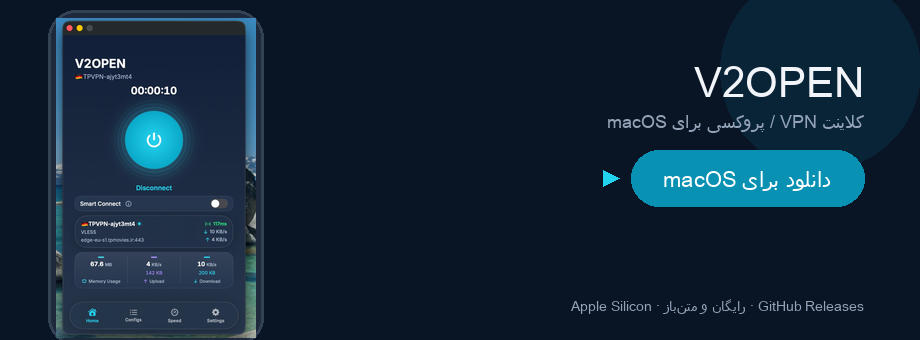

# V2Open

کلاینت محلی VPN / پروکسی برای macOS. کانفیگ‌ها، مسیرها، DNS و پشتیبان‌ها روی همین مک می‌مانند مگر خودتان خروجی بگیرید یا همگام‌سازی iCloud را روشن کنید.

V2Open سرویس VPN نمی‌فروشد و سرورهای کانفیگ شما را اداره نمی‌کند. اپ هسته‌های [sing-box](https://github.com/SagerNet/sing-box) یا [Xray](https://github.com/XTLS/Xray-core) را روی مک شما اجرا می‌کند.

<p align="center">
  <a href="https://github.com/DinonowDev/v2open/releases/latest">
    
  </a>
</p>

<p align="center">
  <a href="https://github.com/DinonowDev/v2open/releases/latest"></a>
  &nbsp;
  <a href="#دانلود"></a>
  &nbsp;
  <a href="README.md#download"></a>
</p>

## دانلود {#دانلود}

**[→ دریافت آخرین نسخه (zip مک)](https://github.com/DinonowDev/v2open/releases/latest)**

1. از [GitHub Releases](https://github.com/DinonowDev/v2open/releases) فایل `V2Open-*-macos-arm64.zip` را بگیرید.
2. از zip خارج کنید و **V2Open.app** را به **Programs** بکشید.
3. بار اول: **Right-click → Open** اگر macOS هشدار امضا داد، یا `xattr -cr /Applications/V2Open.app`.

برای **Apple Silicon** zip آماده کافی است. **مک Intel:** با `./build-macos.sh` و [باینری‌های](docs/binaries.md) مناسب arch خودتان بیلد بگیرید. گاهی نسخهٔ آزمایشی در artifact **`V2Open-macos-arm64`** داخل [Actions](https://github.com/DinonowDev/v2open/actions) (۱۴ روز) هست.

سند انگلیسی: [README.md](README.md)

| | |
| --- | --- |
| **نسخه فعلی** | `1.1.0` (بیلد `2`) — فایل [`VERSION`](VERSION) |
| **پلتفرم** | macOS ۱۳ به بالا |
| **منبع** | [github.com/DinonowDev/v2open](https://github.com/DinonowDev/v2open) |
| **توسعه‌دهنده** | امیرحسین رضایی |
| **مشارکت** | [CONTRIBUTING.fa.md](CONTRIBUTING.fa.md) · [CONTRIBUTING.md](CONTRIBUTING.md) |
| **مستندات** | [docs/README.md](docs/README.md) · [راهنمای کاربر](docs/user-guide.md) |
| **تاریخچه** | [CHANGELOG.md](CHANGELOG.md) |
| **باگ و انتشار** | [Issues](https://github.com/DinonowDev/v2open/issues) · [Releases](https://github.com/DinonowDev/v2open/releases) |
| **امنیت** | [SECURITY.md](SECURITY.md) · [CODE_OF_CONDUCT.md](CODE_OF_CONDUCT.md) |

---

## نمونه رابط کاربری

| صفحهٔ اصلی | کانفیگ‌ها |
| --- | --- |
|  |  |

| تست سرعت | تنظیمات |
| --- | --- |
|  |  |

---

## قابلیت‌ها

- ورود لینک اشتراک (`vless`، `vmess`، `trojan`، `ss`، `ssr`، `hy2`، `hysteria`، `wireguard`، `ssh`، `socks`، `dnstt`، `masterdns`، `ping`، `chain` و …) از کلیپ‌بورد، QR، فایل یا URL scheme
- گروه اشتراک و به‌روزرسانی زمان‌بندی‌شده
- اتصال به‌صورت تونل VPN سیستمی یا پروکسی SOCKS/HTTP محلی
- روتینگ با پیش‌تنظیم (جهانی، ایران، روسیه، چین) یا ویرایشگر قانون
- پینگ، انتخاب بهترین سرور، Smart Connect و تست سرعت داخل اپ
- محدودیت per-app، kill switch، FakeDNS، mux، fragment، Clash API، بالانسر Xray
- پشتیبان محلی، بسته قفل‌شده `.v2box`، همگام‌سازی اختیاری iCloud
- ده زبان رابط از جمله فارسی

مسئولیت کانفیگ‌هایی که وارد می‌کنید و رعایت قوانین کشورتان با شماست.

---

## اجرای توسعه

```bash
./dev-macos.sh run          # بیلد دیباگ و باز کردن V2Open-Dev.app
./dev-watch-macos.sh        # ری‌بیلد با هر ذخیره
./build-macos.sh            # باندل انتشار: V2Open.app
```

داده زمان اجرا در `~/Library/Application Support/V2Open/` ذخیره می‌شود.

---

## مشارکت

قبل از پول‌ریکوئست [CONTRIBUTING.fa.md](CONTRIBUTING.fa.md) را بخوانید. خلاصه:

1. از `main` برنچ بزنید (`feature/`، `fix/`، `docs/` و …).
2. داکیومنت، ترجمه‌ها، تست و `CHANGELOG.md` را در همان PR به‌روز کنید.
3. اگر تغییر برای کاربر دیده می‌شود، نسخه را طبق SemVer بالا ببرید.
4. PR را روی `main` باز کنید و چک‌لیست قالب را پر کنید.

جزئیات کامل: **[CONTRIBUTING.fa.md](CONTRIBUTING.fa.md)**. فهرست اسناد: **[docs/README.md](docs/README.md)** · [user-guide.md](docs/user-guide.md).

---

## حمایت از پروژه

V2Open رایگان و متن‌باز است. اگر برایتان مفید بود، می‌توانید از توسعه حمایت کنید (همان کیف‌پول‌های پروژه‌های [DinonowDev](https://github.com/DinonowDev)، از جمله [LazyDisk](https://github.com/DinonowDev/LazyDisk)):

| شبکه | آدرس |
| --- | --- |
| **TRON (TRC-20)** | `TAcW3UvfPF95Higtyjo133rAAx51Ru8VhB` |
| **Polygon** | `0xF8Ebe674D471cBc5fF9924bE85829090364F4318` |
| **Ethereum** | `0xF8Ebe674D471cBc5fF9924bE85829090364F4318` |
| **Bitcoin** | `0xF8Ebe674D471cBc5fF9924bE85829090364F4318` |

---

## مجوز

کد منبع V2Open تحت **MIT** است: [LICENSE](LICENSE). هسته‌ها، فونت‌ها و فایل‌های geo مجوز خودشان را دارند: [NOTICE](NOTICE).
