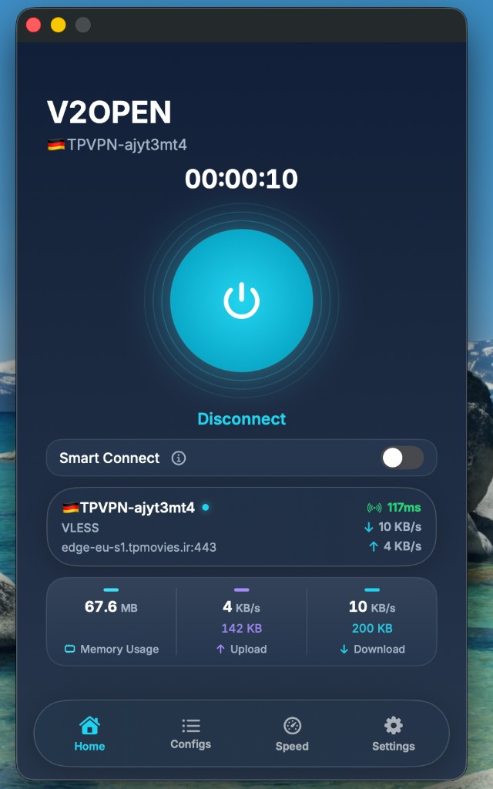
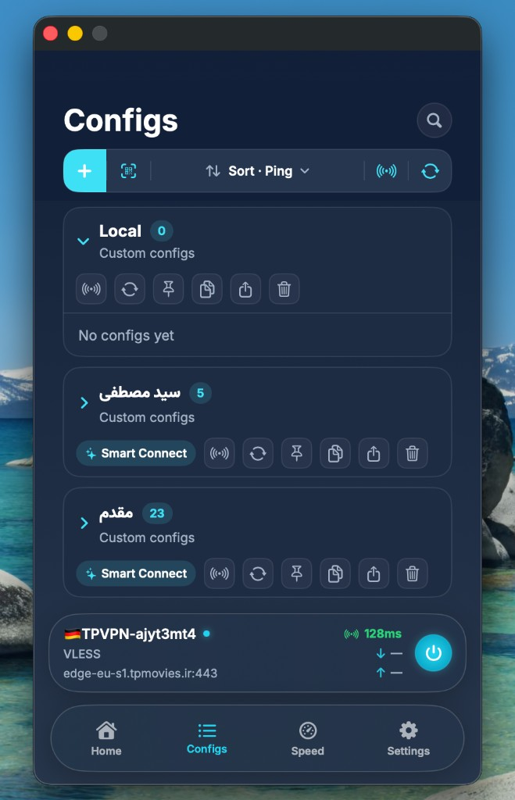
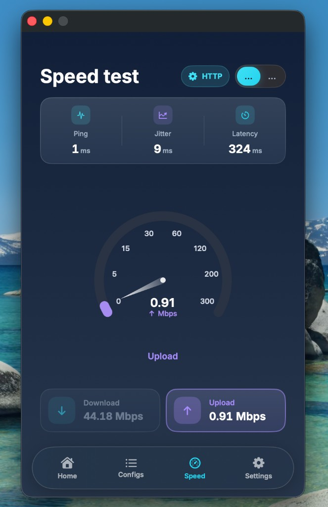
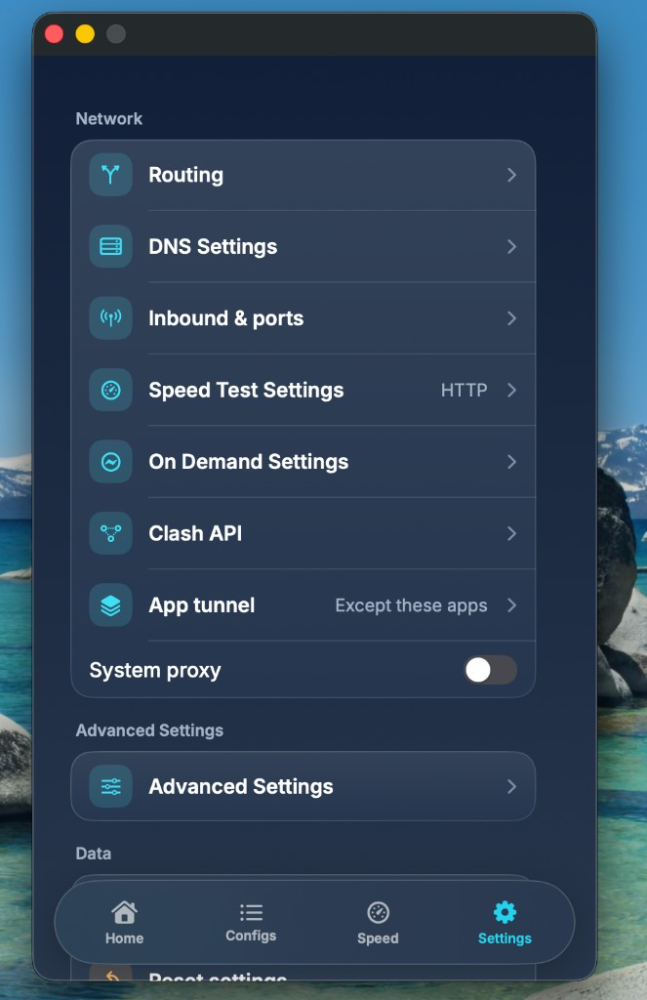

# V2Open

Local macOS VPN / proxy client. Configs, routes, DNS items, and backups stay on this Mac unless you export them or turn on optional iCloud sync.

V2Open is **not** a VPN service. It does not sell bandwidth and does not operate the servers in your configs. It runs [sing-box](https://github.com/SagerNet/sing-box) or [Xray](https://github.com/XTLS/Xray-core) on your machine and lets you manage a local catalog of share links, subscriptions, and routing rules.

<p align="center">
  <a href="https://github.com/DinonowDev/v2open/releases/latest">
    
  </a>
</p>

<p align="center">
  <a href="https://github.com/DinonowDev/v2open/releases/latest"></a>
  &nbsp;
  <a href="#download"></a>
  &nbsp;
  <a href="README.fa.md#دانلود"></a>
</p>

## Download {#download}

**[→ Get the latest release (macOS zip)](https://github.com/DinonowDev/v2open/releases/latest)**

1. Download `V2Open-*-macos-arm64.zip` from [GitHub Releases](https://github.com/DinonowDev/v2open/releases).
2. Unzip and drag **V2Open.app** to **Applications**.
3. First open: **Right-click → Open** if Gatekeeper warns about an unsigned app, or run `xattr -cr /Applications/V2Open.app`.

Apple Silicon Macs use the pre-built zip. **Intel Macs:** build from source with `./build-macos.sh` and matching [engine binaries](docs/binaries.md). Pre-release builds sometimes appear as the **`V2Open-macos-arm64`** artifact on [Actions](https://github.com/DinonowDev/v2open/actions) (14-day retention). Maintainers: [docs/release.md](docs/release.md).

Persian overview: [README.fa.md](README.fa.md)

| | |
| --- | --- |
| **Current version** | `1.1.0` (build `2`) — see [`VERSION`](VERSION) |
| **Platform** | macOS 13+ (Apple Silicon and Intel) |
| **UI** | SwiftUI desktop client |
| **Core** | Rust `v2core` static library |
| **Engines** | Bundled `sing-box` and `xray` |
| **Source** | [github.com/DinonowDev/v2open](https://github.com/DinonowDev/v2open) |
| **License** | MIT ([LICENSE](LICENSE); third-party: [NOTICE](NOTICE)) |
| **Author** | Amirhossein Rezaei |
| **Contributing** | [CONTRIBUTING.md](CONTRIBUTING.md) · [CONTRIBUTING.fa.md](CONTRIBUTING.fa.md) |
| **Documentation** | [docs/README.md](docs/README.md) · [User guide](docs/user-guide.md) |
| **Changelog** | [CHANGELOG.md](CHANGELOG.md) |
| **Issues & releases** | [Issues](https://github.com/DinonowDev/v2open/issues) · [Releases](https://github.com/DinonowDev/v2open/releases) |
| **Security** | [SECURITY.md](SECURITY.md) · [CODE_OF_CONDUCT.md](CODE_OF_CONDUCT.md) |

---

## Screenshots

| Home | Configs |
| --- | --- |
|  |  |

| Speed test | Settings |
| --- | --- |
|  |  |

---

## What it does

- Import share links (`vless`, `vmess`, `trojan`, `ss`, `ssr`, `hy2`, `hysteria`, `wireguard`, `ssh`, `socks`, `dnstt`, `masterdns`, `ping`, `chain`, …) from clipboard, QR, file, or URL scheme.
- Pull subscription groups and refresh them on a schedule.
- Connect as a **system VPN tunnel** (Network Extension) or as **local SOCKS/HTTP proxy**.
- Route traffic with presets (global, Iran, Russia, China white/black) or a custom rule editor.
- Ping, pick the best node, Smart Connect, and an in-app speed test.
- Optional per-app include/exclude, kill switch, FakeDNS, mux, fragment, Clash API, Xray balancers.
- Local backups, password-locked `.v2box` packages, optional iCloud sync.
- Ten UI languages: English, فارسی, العربية, Indonesia, Русский, Türkçe, Українська, Tiếng Việt, 中文, 简体中文.

You are responsible for the configs you import and for complying with the laws of your country. See in-app Terms and Privacy under **Settings → About**.

---

## Requirements

- macOS 13.0 or later
- Xcode Command Line Tools (`xcrun`, `swiftc`)
- [Rust](https://rustup.rs) / Cargo (stable)
- Bundled engine binaries in `binaries/macos/` (`sing-box`, `xray`, `masterdns`, `dnstt-client`, `pingtunnel`, plus `geoip.dat` / `geosite.dat`)
- For live reload: `fswatch` (`brew install fswatch`)

VPN mode needs a signed Network Extension. Unsigned `V2Open-Dev.app` falls back to starting the core process directly (proxy / local engine, not a full system tunnel).

---

## Quick start

```bash
# Debug build, then open V2Open-Dev.app
./dev-macos.sh run

# Watch Swift + Rust and relaunch on save
./dev-watch-macos.sh

# Release bundle: V2Open.app
./build-macos.sh
```

Useful debug commands:

```bash
./dev-macos.sh run-logs   # app in this terminal, core log tailed
./dev-macos.sh logs       # tail runtime + core logs
./dev-macos.sh console    # run the binary in the foreground
./dev-macos.sh lldb
./dev-macos.sh clean
```

Runtime data lives in `~/Library/Application Support/V2Open/` (`library.json`, `config.json`, `core.log`, rulesets). Dev UI logs also go to `dev-logs/runtime.log` in the repo.

---

## Repository layout

```
macos-app/          SwiftUI app, Packet Tunnel extension, locales, icons
native/core/        Rust library v2core (parser, builder, RPC, sidecars)
binaries/macos/     Bundled engines and geo databases
assets/             Fonts, routing presets, rulesets
docs/               Architecture, user guide, RPC, versioning, tests
scripts/            Version bump and locale/version checks
dev-macos.sh        Debug build / run
dev-watch-macos.sh  Live reload
build-macos.sh      Release build
macos-env.sh        Shared compiler / codesign helpers
VERSION             Marketing version + build number (source of truth)
CHANGELOG.md        User-facing history
```

---

## Documentation

| Document | What it covers |
| --- | --- |
| [docs/README.md](docs/README.md) | Documentation index and update map |
| [docs/user-guide.md](docs/user-guide.md) | Screens, settings, protocols, URL schemes |
| [docs/architecture.md](docs/architecture.md) | App / core / tunnel design |
| [docs/development.md](docs/development.md) | Build, run, debug, codesign |
| [docs/rpc.md](docs/rpc.md) | `v2_call` methods |
| [docs/localization.md](docs/localization.md) | Locale files and fallbacks |
| [docs/testing.md](docs/testing.md) | Rust tests and live matrix |
| [docs/versioning.md](docs/versioning.md) | SemVer, files to bump, changelog |
| [docs/branching.md](docs/branching.md) | Branches, tags, pull requests |
| [docs/release.md](docs/release.md) | Cut a release |
| [docs/binaries.md](docs/binaries.md) | Bundled engines and how to replace them |
| [docs/signing.md](docs/signing.md) | Codesign and Packet Tunnel |
| [docs/github.md](docs/github.md) | Protect `main` and repo settings |
| [NOTICE](NOTICE) | Third-party licenses |
| [CONTRIBUTING.md](CONTRIBUTING.md) | How to contribute (required reading) |
| [CONTRIBUTING.fa.md](CONTRIBUTING.fa.md) | همان سند به فارسی |
| [CODE_OF_CONDUCT.md](CODE_OF_CONDUCT.md) | Community rules |
| [SECURITY.md](SECURITY.md) | Vulnerability reports |

**Every change that affects behavior, UI, RPC, settings, or public docs must update the matching document and, when user-visible, `CHANGELOG.md`.** Version-bearing releases must bump [`VERSION`](VERSION) and the files listed in [docs/versioning.md](docs/versioning.md). Pull requests that skip this are incomplete.

---

## Contributing

Read [CONTRIBUTING.md](CONTRIBUTING.md) before opening a pull request. Short version:

1. Branch from `main` with the right prefix (`feature/`, `fix/`, `docs/`, …).
2. Keep the change focused. Update docs, locales, tests, and changelog in the same PR.
3. If the change is user-facing, bump the version and build according to SemVer.
4. Open a PR against `main` using the template. Do not merge your own PR without review when another reviewer is available.

Full workflow, branch naming, and review expectations: **[CONTRIBUTING.md](CONTRIBUTING.md)**. Documentation index: **[docs/README.md](docs/README.md)**.

---

## Support the project

V2Open is free and open source. If you find it useful, consider supporting development (same wallets as other [DinonowDev](https://github.com/DinonowDev) projects):

| Network | Address |
| --- | --- |
| **TRON (TRC-20)** | `TAcW3UvfPF95Higtyjo133rAAx51Ru8VhB` |
| **Polygon** | `0xF8Ebe674D471cBc5fF9924bE85829090364F4318` |
| **Ethereum** | `0xF8Ebe674D471cBc5fF9924bE85829090364F4318` |
| **Bitcoin** | `0xF8Ebe674D471cBc5fF9924bE85829090364F4318` |

---

## License and trademark

V2Open application source is **MIT**. See [LICENSE](LICENSE).

Copyright © 2026 Amirhossein Rezaei. The name V2Open and the app icon are used for this project. Bundled engines, fonts, and geo files keep **their own** licenses; see [NOTICE](NOTICE). You must have the right to use those binaries and any servers you connect to.

Pull requests are accepted under the same MIT terms as the rest of this source.
