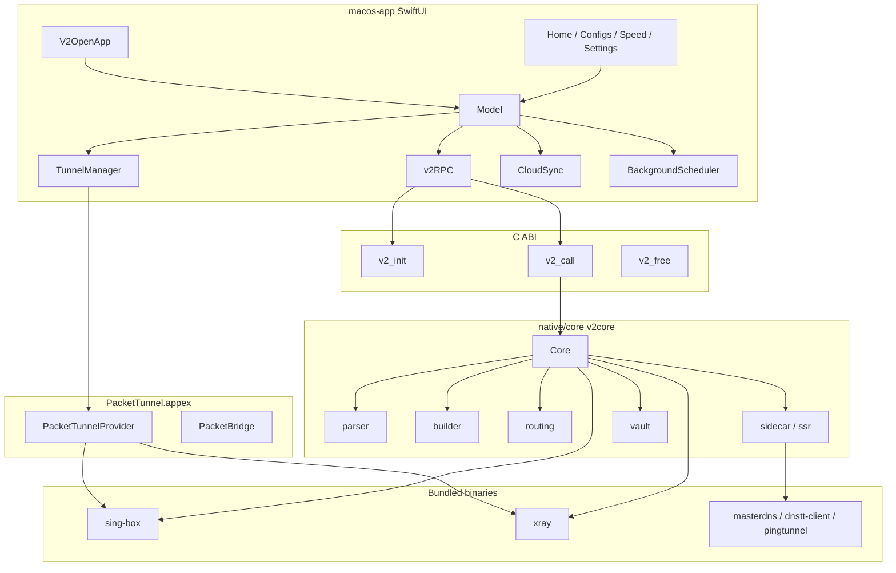

# Architecture

V2Open is a **local macOS app**: SwiftUI talks to a Rust static library over a tiny C ABI. The library owns the catalog, builds engine JSON, and either launches `sing-box` / Xray itself or hands a config path to a Packet Tunnel extension.



---

## Process and bundle IDs

| Build | App bundle | App ID | Tunnel ID | Output |
| --- | --- | --- | --- | --- |
| Release | `V2Open.app` | `local.v2open.desktop` | `local.v2open.desktop.PacketTunnel` | `./build-macos.sh` |
| Dev | `V2Open-Dev.app` | `local.v2open.dev` | `local.v2open.dev.PacketTunnel` | `./dev-macos.sh` |

Minimum system: macOS 13 (`LSMinimumSystemVersion`). Swift/Rust deployment target defaults to 14.0 via `macos-env.sh`, clamped down to the host OS if needed so Launch Services will still `open` the app.

Window size is fixed (`AppFrame`: 418×684) with a hidden title bar. Four tabs: Home, Configs, Speed, Settings. Deeper screens push onto `Model.stack`.

---

## Boot sequence

1. `V2OpenApp.init` installs `DevLog` and, if argv contains `--agent` / `--daemon`, runs `BackgroundScheduler` instead of the UI.
2. `Model.boot()` creates `~/Library/Application Support/V2Open/`, then `v2_init(supportDir, pathToSingBox, rulesDir)`.
3. Rust `Core::open` loads `library.json` (or seeds defaults), runs `migrate_settings`, copies bundled rulesets/geo files if missing.
4. Swift calls `state` and `about`, applies the selected app icon, arms on-demand VPN rules, starts the 60s auto-ping loop and a `tick` timer.
5. `UILock` keeps a file lock so a Launch Agent daemon will idle while the UI owns the library.

If the last window closes, the app **stays open** when geo auto-update, on-demand, persist-tunnel, or subscription auto-update is on.

---

## FFI contract

Defined in `native/core/src/lib.rs` and imported from Swift with `@_silgen_name` in `macos-app/Sources/Core/V2RPC.swift`.

| Symbol | Role |
| --- | --- |
| `v2_init(data_dir, singbox_path, rules_dir) -> i32` | Construct the process-wide `Core`. `0` is success. |
| `v2_call(method, args_json) -> *mut c_char` | JSON in, JSON out: `{"ok":true,"data":…}` or `{"ok":false,"error":"…"}`. Caller **must** `v2_free`. |
| `v2_free(ptr)` | Drops the CString. |

`v2core` is `crate-type = ["rlib", "staticlib"]` and **macOS-only** (`compile_error` on other OS). Swift links `-lv2core` plus C++/iconv.

Special-case methods `speed`, `speed_start`, and `speed_progress` run **without** holding the `Core` mutex for the whole probe so the UI can poll progress.

Full method list: [rpc.md](rpc.md).

---

## Library format

On disk: `~/Library/Application Support/V2Open/library.json`.

Approximate shape (owned by `Core`):

```json
{
  "settings": { },
  "groups": [ { "id": "", "name": "", "url": "", "profiles": [ ] } ],
  "routes": [ ],
  "backups": [ ]
}
```

- `settings` keys are created in `defaults()` (`app.rs`) and backfilled by `migrate_settings()` (`migrate.rs`) so older files keep running.
- Adding a key: put it in `defaults()`, add a `migrate_settings` branch if an old name exists, expose it in Swift via `model.set("key", value)`, document it in [user-guide.md](user-guide.md), and add locale strings.
- `reset` restores defaults but keeps profiles. `erase` wipes the library.

Runtime (not persisted) lives in `Core.runtime`: connected flag, phase (`idle` / `connecting` / `error`), speeds, engine name, tunnel kind, SSID, etc. Swift reads it from `state.runtime`.

---

## Engines

`builder.rs` turns settings + selected profiles + route rules into a sing-box JSON document. `xray.rs` / `xray_balancers.rs` do the Xray equivalent when the engine is Xray.

| Engine | Binary in bundle | When |
| --- | --- | --- |
| sing-box | `Contents/MacOS/sing-box` | Default. TUN or proxy. |
| Xray | `Contents/MacOS/xray` | Xray outbound / advanced settings. Optional `use_xray_tun`. |

`prepare` writes `config.json` next to the library and returns the path, SOCKS port, MTU, DNS, and whether the Packet Tunnel should launch the core (`launch_core`). Swift then either:

- Starts `NETunnelProviderManager` (release / signed builds that contain `PacketTunnel.appex`), or
- Calls `connect`, which spawns the engine as a child of the app (dev unsigned path).

`mark_connected` updates runtime after the system VPN actually comes up.

---

## Packet Tunnel

`macos-app/PacketTunnel/PacketTunnelProvider.swift` is a Network Extension (`com.apple.networkextension.packet-tunnel`).

- Reads provider configuration (config path, engine, SOCKS port, MTU, DNS, include-local).
- Optionally launches `sing-box` or `xray` as a child `Process`.
- Applies `NEPacketTunnelNetworkSettings`.
- `PacketBridge` copies packets between the tunnel and the local SOCKS port when needed.
- App messages: `status` and `reload` (used by persist-tunnel so a reconnect does not tear the session down).

Entitlements: `macos-app/V2Open.entitlements` and `PacketTunnel/PacketTunnel.entitlements` (`packet-tunnel-provider`, app group `group.local.v2open`). Unsigned ad-hoc codesign is the fallback in `macos-env.sh`. How to sign for a real system VPN: [signing.md](signing.md). Engine files: [binaries.md](binaries.md).

---

## Sidecars

Protocols that are not native outbounds are adapted in `sidecar.rs` (and `ssr.rs` for ShadowsocksR):

| Protocol | Helper binary | Result |
| --- | --- | --- |
| `shadowsocksr` | in-process SSR (`ssr.rs`) | Local SOCKS the engine can use |
| `masterdns` | `masterdns` | Local SOCKS |
| `dnstt` | `dnstt-client` | Local SOCKS |
| `ping` | `pingtunnel` (may ask for admin via osascript) | Local SOCKS |

`adapt_all` runs before `build_config`. On disconnect, sidecar children are killed.

---

## Connection modes

| `settings.mode` | Meaning |
| --- | --- |
| `tun` | System VPN (or core TUN if the extension is missing) |
| `proxy` | Local SOCKS (`socks_port`, default 10808) and HTTP (`http_port`, default 10807). Optional `apply_system_proxy`. |

Related flags: `kill_switch`, `include_local`, `include_all_networks`, `include_apns`, `include_cellular_services`, `enforce_routes`, `net_combiner`, `per_app_mode` (`off` / `include` / `exclude`).

---

## Background work

`BackgroundScheduler` writes `~/Library/LaunchAgents/app.v2open.scheduler.plist` when any of these is on: geo auto-update, on-demand, persist-tunnel / reconnect-after-wake, subscription auto-update.

The agent launches the same executable with `--daemon` and calls `tick` every few seconds **only if** `UILock` is not held by the GUI.

`tick` refreshes traffic counters, runs due geo/subscription updates, and Smart Connect probes.

Sleep / wake: `NSWorkspace.willSleepNotification` may disconnect (`stop_on_sleep`, default on) and flush iCloud; `didWakeNotification` may reconnect (`reconnect_after_wake`).

---

## iCloud

`Cloud.swift` uses CloudKit container `iCloud.local.v2open.desktop` and also a copy under iCloud Drive when available (`platform.rs` `icloud_library`). Sync is opt-in (`settings.icloud`). Data is under the user’s Apple ID, not a V2Open server.

---

## Localization and theme

- `LocaleStore` loads `Contents/Resources/Locales/<code>.json`. Fallbacks: `Localization.swift` `enText` / `faText`.
- Default `settings.language` is `fa`. RTL for `fa` and `ar`.
- Theme: `dark` / `light` / `system` via `C.apply` in `Theme.swift`. `glassy` is an extra chrome flag.

Details: [localization.md](localization.md).

---

## Logging

| Log | Path | When |
| --- | --- | --- |
| Core | `~/Library/Application Support/V2Open/core.log` | Engine + `v2core` |
| Dev UI | `dev-logs/runtime.log` in the repo | `V2Open-Dev.app` or `V2OPEN_DEV_LOG=1` |
| Access / DNS / error | next to the library | When `logging_enabled` and loglevel ≠ `none` |

`DevLog` is a no-op in the release bundle identifier.

---

## Changing the architecture

If you add a process, a new FFI symbol, or a second store besides `library.json`, update this file, [rpc.md](rpc.md) if methods move, and [user-guide.md](user-guide.md) if the user sees a new mode. That is required by [CONTRIBUTING.md](../CONTRIBUTING.md).
